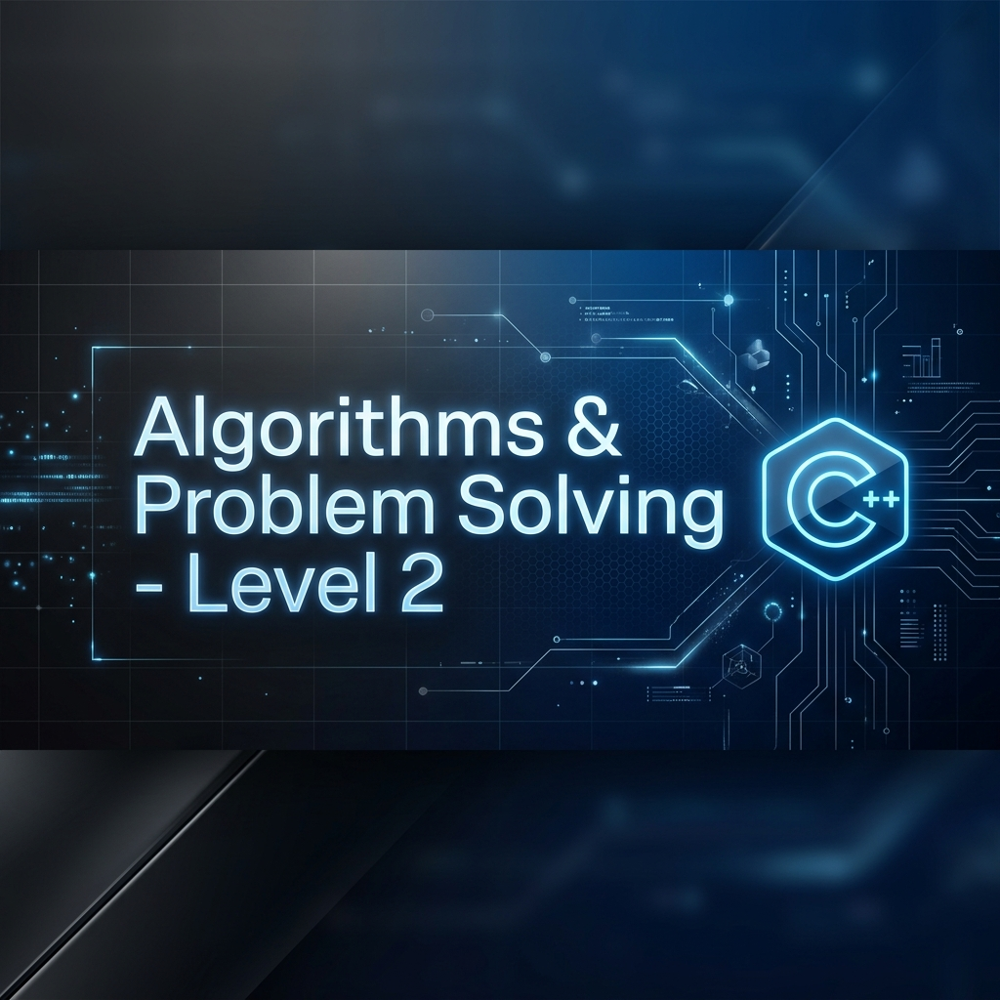

<p align="center"></p>

<h1 align="center">🧩 Algorithms & Problem Solving — Level 2</h1>

<p align="center">
  
  
  
  
</p>

<p align="center">
  <b>Number manipulation, patterns, random generation and array algorithms.</b><br/>Part of the Programming Advices roadmap by Dr. Mohammed Abu-Hadhoud.
</p>

---

## 📚 Problems

### 🔢 Numbers & Digits

| # | Problem |
|:-:|---------|
| 01 | [Multiplication Table 1 to 10](01%20-%20Multiplication%20Table%201%20to%2010) |
| 02 | [Prime Numbers from 1 to N](02%20-%20Prime%20Numbers%20from%201%20to%20N) |
| 03 | [Check Perfect Number](03%20-%20Check%20Perfect%20Number) |
| 04 | [Perfect Numbers from 1 to N](04%20-%20Perfect%20Numbers%20from%201%20to%20N) |
| 05 | [Print Digits in Reverse Order](05%20-%20Print%20Digits%20in%20Reverse%20Order) |
| 06 | [Sum of Digits](06%20-%20Sum%20of%20Digits) |
| 07 | [Reverse a Number](07%20-%20Reverse%20a%20Number) |
| 08 | [Digit Frequency in a Number](08%20-%20Digit%20Frequency%20in%20a%20Number) |
| 09 | [All Digits Frequency](09%20-%20All%20Digits%20Frequency) |
| 10 | [Print Digits in Order](10%20-%20Print%20Digits%20in%20Order) |
| 11 | [Check Palindrome Number](11%20-%20Check%20Palindrome%20Number) |

### 🔤 Patterns & Text

| # | Problem |
|:-:|---------|
| 12 | [Inverted Number Pattern](12%20-%20Inverted%20Number%20Pattern) |
| 13 | [Number Pattern](13%20-%20Number%20Pattern) |
| 14 | [Inverted Letter Pattern](14%20-%20Inverted%20Letter%20Pattern) |
| 15 | [Letter Pattern](15%20-%20Letter%20Pattern) |
| 16 | [Print Words AAA to ZZZ](16%20-%20Print%20Words%20AAA%20to%20ZZZ) |
| 17 | [Guess a 3-Letter Password](17%20-%20Guess%20a%203-Letter%20Password) |
| 18 | [Encrypt and Decrypt Text](18%20-%20Encrypt%20and%20Decrypt%20Text) |

### 🎲 Random Numbers & Keys

| # | Problem |
|:-:|---------|
| 19 | [Random Numbers 1 to 6](19%20-%20Random%20Numbers%201%20to%206) |
| 20 | [Random Character Types](20%20-%20Random%20Character%20Types) |
| 21 | [Generate Random Keys](21%20-%20Generate%20Random%20Keys) |

### 📊 Arrays

| # | Problem |
|:-:|---------|
| 22 | [Number Occurrences in Array](22%20-%20Number%20Occurrences%20in%20Array) |
| 23 | [Fill Array with Random Numbers](23%20-%20Fill%20Array%20with%20Random%20Numbers) |
| 24 | [Max Number in Random Array](24%20-%20Max%20Number%20in%20Random%20Array) |
| 25 | [Min Number in Random Array](25%20-%20Min%20Number%20in%20Random%20Array) |
| 26 | [Sum of Array Elements](26%20-%20Sum%20of%20Array%20Elements) |
| 27 | [Average of Array Elements](27%20-%20Average%20of%20Array%20Elements) |
| 28 | [Copy Array Elements](28%20-%20Copy%20Array%20Elements) |
| 29 | [Copy Prime Numbers to New Array](29%20-%20Copy%20Prime%20Numbers%20to%20New%20Array) |
| 30 | [Sum of Two Random Arrays](30%20-%20Sum%20of%20Two%20Random%20Arrays) |
| 31 | [Shuffle Array Elements](31%20-%20Shuffle%20Array%20Elements) |
| 32 | [Copy Array in Reverse Order](32%20-%20Copy%20Array%20in%20Reverse%20Order) |
| 33 | [Generate Keys Array](33%20-%20Generate%20Keys%20Array) |
| 34 | [Search Number in Array](34%20-%20Search%20Number%20in%20Array) |
| 35 | [Check if Number is in Array](35%20-%20Check%20if%20Number%20is%20in%20Array) |

### 🧱 Semi-Dynamic Arrays

| # | Problem |
|:-:|---------|
| 36 | [Add Element to Array Semi Dynamically](36%20-%20Add%20Element%20to%20Array%20Semi%20Dynamically) |
| 37 | [Copy Array Semi Dynamically](37%20-%20Copy%20Array%20Semi%20Dynamically) |
| 38 | [Copy Odd Numbers Semi Dynamically](38%20-%20Copy%20Odd%20Numbers%20Semi%20Dynamically) |
| 39 | [Copy Prime Numbers Semi Dynamically](39%20-%20Copy%20Prime%20Numbers%20Semi%20Dynamically) |
| 40 | [Copy Distinct Elements Semi Dynamically](40%20-%20Copy%20Distinct%20Elements%20Semi%20Dynamically) |

### 🔍 Array Checks & Counting

| # | Problem |
|:-:|---------|
| 41 | [Check Palindrome Array](41%20-%20Check%20Palindrome%20Array) |
| 42 | [Count Odd Numbers in Array](42%20-%20Count%20Odd%20Numbers%20in%20Array) |
| 43 | [Count Even Numbers in Array](43%20-%20Count%20Even%20Numbers%20in%20Array) |
| 44 | [Count Positive Numbers in Array](44%20-%20Count%20Positive%20Numbers%20in%20Array) |
| 45 | [Count Negative Numbers in Array](45%20-%20Count%20Negative%20Numbers%20in%20Array) |

### 🧮 Re-implementing Math Functions

| # | Problem |
|:-:|---------|
| 46 | [My Absolute Function (abs)](46%20-%20My%20Absolute%20Function%20%28abs%29) |
| 47 | [My Round Function (round)](47%20-%20My%20Round%20Function%20%28round%29) |
| 48 | [My Floor Function (floor)](48%20-%20My%20Floor%20Function%20%28floor%29) |
| 49 | [My Ceil Function (ceil)](49%20-%20My%20Ceil%20Function%20%28ceil%29) |
| 50 | [My Square Root Function (sqrt)](50%20-%20My%20Square%20Root%20Function%20%28sqrt%29) |

## 🚀 Projects

| # | Project |
|:-:|---------|
| 01 | [Rock Paper Scissors Game](Project%2001%20-%20Rock%20Paper%20Scissors%20Game) |
| 02 | [Math Quiz Game](Project%2002%20-%20Math%20Quiz%20Game) |

---

## ▶️ How to Run

Each folder is a standalone Visual Studio project. Open the `.slnx` file in Visual Studio 2022 or later and press **Ctrl + F5**, or compile the `.cpp` file directly:

```bash
g++ -std=c++17 "file.cpp" -o app && ./app
```

---

<p align="center"><a href="../README.md">⬅️ Back to all courses</a></p>
