<h1 align="center">🚀 Programming Foundations</h1>

<p align="center">
  <b>My journey from zero to software engineer — every lesson, problem and project I've built along the way.</b><br/>
  Following the <b>Programming Advices</b> roadmap by <b>Dr. Mohammed Abu-Hadhoud</b>.
</p>

<p align="center">
  
  
  
  
</p>

<p align="center">
  
  
  
  
  
</p>

---

## 📑 Table of Contents

- [Course Structure](#-course-structure)
- [Learning Path](#️-learning-path)
- [Skills Covered](#-skills-covered)
- [Highlighted Projects](#-highlighted-projects)
- [How to Run the Code](#️-how-to-run-the-code)
- [About Me](#-about-me)

---

## 📂 Course Structure

Every course has its own folder and its own `README.md` with a full index of lessons and problems.

### 💻 C++ Programming

| # | Course | Content | Status |
|:-:|--------|---------|:------:|
| 03 | [Introduction to Programming with C++ — Level 1](03%20-%20Introduction%20to%20Programming%20with%20C%2B%2B%20%E2%80%93%20Level%201) | 53 lessons — variables, conditions, loops, structures, enums, arrays, functions | ✅ |
| 06 | [Introduction to Programming Using C++ — Level 2](06%20-%20Introduction%20to%20Programming%20Using%20C%2B%2B%20Level%202) | 62 lessons — debugging, pointers, memory, vectors, files, date & time | ✅ |

### 🧩 Algorithms & Problem Solving

| # | Course | Content | Status |
|:-:|--------|---------|:------:|
| 04 | [Algorithms & Problem Solving — Level 1](04%20-%20Algorithms%20%26%20Problem-Solving%20%E2%80%93%20Level%201%20%28Solutions%29) | 48 problems — I/O, conditions, loops, math | ✅ |
| 05 | [Algorithms & Problem Solving — Level 2](05-%20Algorithms-Problem-Solving-Level-2-05) | 50 problems + 2 projects — digits, patterns, random numbers, arrays | ✅ |
| 07 | [Algorithms & Problem Solving — Level 3](07%20-%20Algorithms%20%26%20Problem%20Solving%20Level%203) | 51 problems + 2 projects — matrices, strings, Bank System | ✅ |
| 08 | [Algorithms & Problem Solving — Level 4](08%20-%20Algorithms%20%26%20Problem%20Solving%20Level%204) | 65 problems + 2 projects — dates & calendars, Bank extension, ATM System | ✅ |
| 13 | [Algorithms & Problem Solving — Level 5](13%20-%20Algorithms%20%26%20Problem%20Solving%20Level%205) | Templates, linked lists, stacks, queues, dynamic arrays + 8 projects | ✅ |

### 🏛️ Object-Oriented Programming

| # | Course | Content | Status |
|:-:|--------|---------|:------:|
| 10 | [OOP as it Should Be](10%20-%20OOP) | 33 lessons — classes, inheritance, polymorphism, abstraction, libraries | ✅ |
| 11 | [OOP as it Should Be — Applications](11-%20Opp%20Applications) | 32 steps — full OOP Bank System with users, permissions, login & currency exchange | ✅ |

### 🧱 Data Structures

| # | Course | Content | Status |
|:-:|--------|---------|:------:|
| 12 | [Data Structures — Level 1](12%20-%20Data%20Structures%20-%20Level1) | 26 lessons — STL stack, queue & map, singly and doubly linked lists, unions | ✅ |

### 🌐 Foundations

| # | Course | Content | Status |
|:-:|--------|---------|:------:|
| 09 | [Foundations — Level 2](09%20-%20Foundations%20Level%202) | 33 lessons — networks, IP, DNS, HTTP, APIs, JSON, software architecture | ✅ |

### 🗄️ Database

| # | Course | Content | Status |
|:-:|--------|---------|:------:|
| 15 | [Database Level 1 — SQL](15%20-%20Database%20Level%201%20-%20SQL) | 88 lessons — ERD, relational schema, SQL Server, joins, constraints, normalization | ✅ |

> 📝 Courses **01 and 02** in the roadmap are theory-only, so they have no code in this repository.

---

## 🗺️ Learning Path

```mermaid
flowchart LR
    A["03 · C++ Level 1"] --> B["04 · Problem Solving 1"]
    B --> C["05 · Problem Solving 2"]
    C --> D["06 · C++ Level 2"]
    D --> E["07 · Problem Solving 3"]
    E --> F["08 · Problem Solving 4"]
    F --> G["09 · Foundations 2"]
    G --> H["10 · OOP"]
    H --> I["11 · OOP Applications"]
    I --> L["12 · Data Structures 1"]
    L --> J["13 · Problem Solving 5"]
    J --> K["15 · Database & SQL"]
```



---

## 🧠 Skills Covered

| Area | Topics |
|------|--------|
| **C++ Core** | Variables, control flow, functions, structures, enums, recursion, pointers, references, dynamic memory, vectors, files |
| **Problem Solving** | Algorithmic thinking, number & digit problems, patterns, 2D arrays & matrices, string processing, date algorithms |
| **OOP** | Encapsulation, inheritance, polymorphism, abstract classes, interfaces, templates, separating classes into libraries |
| **Data Structures** | Singly & doubly linked lists, stacks, queues, dynamic arrays, undo/redo |
| **Databases** | ERD design, relational schema, SQL Server, DDL & DML, joins, views, constraints, indexes, normalization (1NF–3NF) |
| **Foundations** | Networking, IP & DNS, HTTP/HTTPS, APIs, JSON, tier architecture |
| **Tools** | Visual Studio debugging (breakpoints, watch, step into/over/out), Git & GitHub |

---

## ⭐ Highlighted Projects

| Project | Course | Description |
|---------|:------:|-------------|
| [Bank System (OOP)](11-%20Opp%20Applications) | 11 | Full console banking app: clients, users, permissions, login, transfers, currency exchange |
| [ATM System](08%20-%20Algorithms%20%26%20Problem%20Solving%20Level%204/Project%202%20-%20ATM%20System%20%28Solution%20Me%29) | 08 | ATM with login, quick withdraw, normal withdraw, deposit and balance check |
| [Bank System](07%20-%20Algorithms%20%26%20Problem%20Solving%20Level%203) | 07 | File-based client management: add, update, delete, find, transactions |
| [Queue Line Management System](13%20-%20Algorithms%20%26%20Problem%20Solving%20Level%205/Queue%20Line%20Management%20System%20Ahmed%20Darwish) | 13 | Ticket queue system, rebuilt in Java |
| [Rock Paper Scissors](05-%20Algorithms-Problem-Solving-Level-2-05/Project%2001%20-%20Rock%20Paper%20Scissors%20Game) & [Math Quiz](05-%20Algorithms-Problem-Solving-Level-2-05/Project%2002%20-%20Math%20Quiz%20Game) | 05 | Console games with rounds, scoring and random generation |

---

## ▶️ How to Run the Code

**C++ (Visual Studio)**: open the `.slnx` file in any lesson or problem folder with Visual Studio 2022 or later, then press **Ctrl + F5**.

**C++ (any compiler)**:

```bash
g++ -std=c++17 "path/to/file.cpp" -o app && ./app
```

**SQL**: open the `.sql` files in SQL Server Management Studio (SSMS) and run them against a local SQL Server instance.

**Java**: open the project folder in IntelliJ IDEA and run `Main.java`.

---

## 👨‍💻 About Me

**Ahmed Darwish** — Software Engineering student. I share my learning journey, projects and study notes here.

<p>
  <a href="https://darwish.xo.je"></a>
  <a href="https://github.com/dariwsh"></a>
  <a href="https://www.linkedin.com/in/ahmed-darwish-33b752330/"></a>
</p>

> 💡 **Got advice for me?** I'd love to hear it. Feel free to [open an issue](https://github.com/dariwsh/Programming-Foundations/issues) or reach out through the links above.

---

## 📄 License

This project is licensed under the [MIT License](LICENSE).

<p align="center">
  <b>⭐ If you found this helpful, give the repo a star! ⭐</b>
</p>
